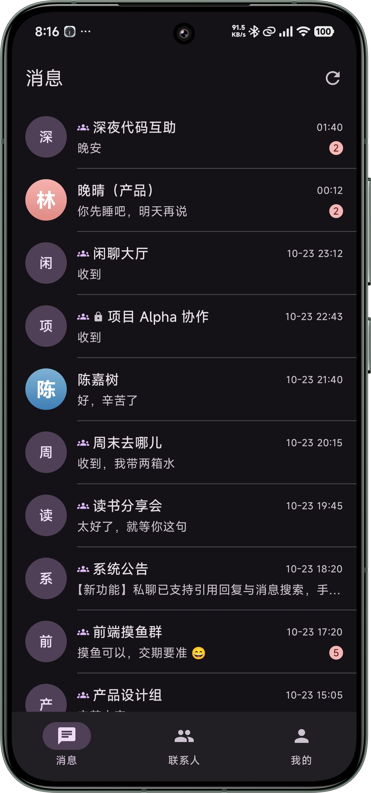
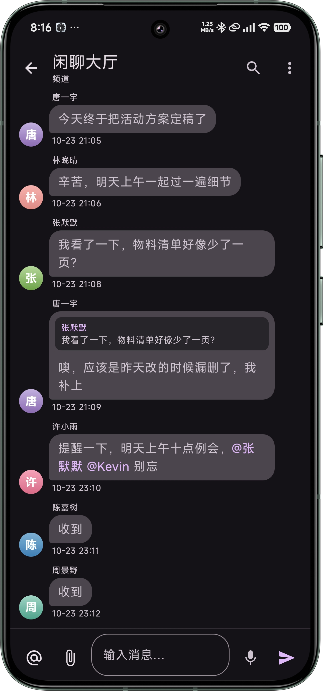
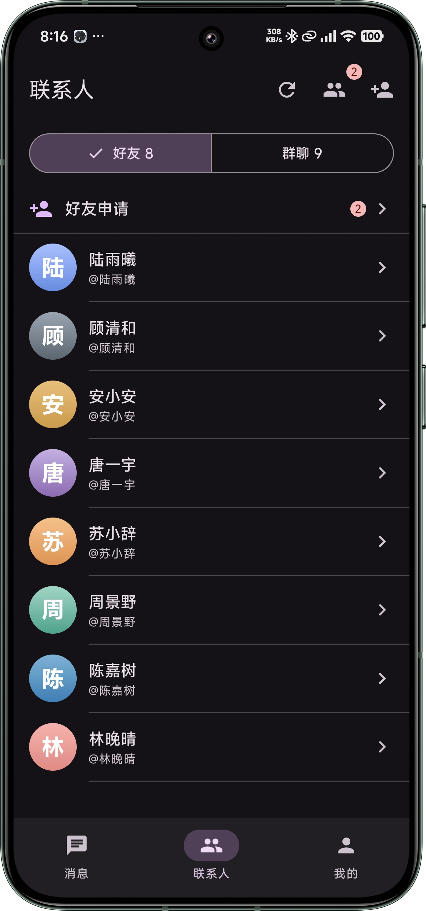
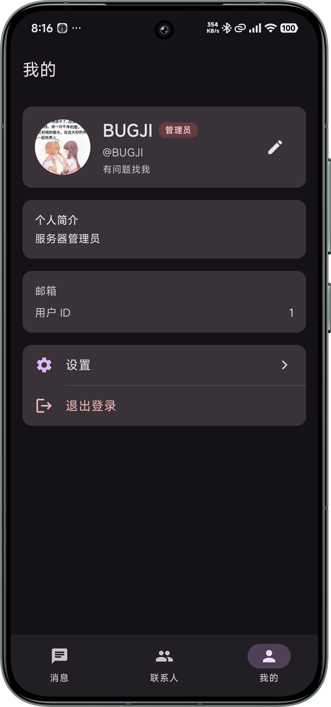

# Lightchat for Android

[](https://github.com/BUGJI/lightchat-android/actions/workflows/ci.yml)
[](https://github.com/BUGJI/lightchat-android/releases/latest)
[](https://developer.android.com)

Lightchat 的官方 Android 客户端，使用 Kotlin 与 Jetpack Compose 构建，配套服务端为 [lightchat_php](https://github.com/BUGJI/lightchat_php)。

## 截图

<p align="center">
  
  
  
  
</p>

## 功能

- **账号**：注册、登录、找回密码、邮箱验证、两步验证（2FA）
- **聊天**：私聊、频道、通讯录与好友管理
- **消息**：文字、图片、文件、语音消息，支持上传进度与图片预览
- **离线体验**：本地缓存、发送队列，断网时文字消息自动排队，恢复联网后发送
- **个性化**：浅色 / 深色 / 跟随系统外观、通知设置、会话管理
- **系统功能**：服务器地址配置、服务器状态、存储管理、应用内更新

## 下载

前往 [Releases](https://github.com/BUGJI/lightchat-android/releases/latest) 下载最新 APK。

## 环境要求

- JDK 25
- Android SDK Platform 37
- Android Build Tools 37.0.0
- 最低运行版本：Android 7.0（API 24）

## 构建

```bash
git clone https://github.com/BUGJI/lightchat-android.git
cd lightchat-android
./gradlew assembleDebug
```

Windows 使用：

```bat
gradlew.bat assembleDebug
```

构建产物位于 `app/build/outputs/apk/debug/app-debug.apk`。

运行单元测试与代码检查：

```bash
./gradlew testDebugUnitTest
./gradlew lintDebug
```

## 发布

推送形如 `v1.2.3` 的标签会自动触发 [Release 工作流](.github/workflows/release.yml)，构建签名 APK 并创建 GitHub Release。

发布签名依赖以下环境变量或仓库 Secrets：

| 名称 | 说明 |
| --- | --- |
| `KEYSTORE_BASE64` | Base64 编码的签名密钥库 |
| `KEYSTORE_FILE` | 密钥库文件路径（本地构建时使用） |
| `KEYSTORE_PASSWORD` | 密钥库密码 |
| `KEY_ALIAS` | 密钥别名 |
| `KEY_PASSWORD` | 密钥密码 |
| `VERSION_NAME` | 版本名称，默认 `1.0.6` |
| `VERSION_CODE` | 版本号，默认 `10006` |

## 技术栈

- Kotlin 2.2.10、Jetpack Compose（Material 3）
- Navigation Compose、Lifecycle、DataStore
- Room、Kotlinx Serialization
- Retrofit 3、OkHttp 5、Coil
- AGP 9.4.1、Gradle 9.8、KSP

## 项目结构

```text
app/src/main/java/com/benton/lightchat/
├── data/
│   ├── remote/        # 网络接口
│   ├── local/         # Room 数据库与实体
│   ├── cache/         # 本地缓存
│   ├── repository/    # 数据仓库
│   └── sync/          # 同步与发送队列
├── ui/
│   ├── auth/          # 登录、注册、找回密码
│   ├── chats/         # 会话与聊天
│   ├── contacts/      # 通讯录与好友
│   ├── channel/       # 频道
│   ├── profile/       # 个人资料与设置
│   ├── server/        # 服务器配置
│   └── navigation/    # 导航
└── util/
```

## 服务端

服务端项目：[BUGJI/lightchat_php](https://github.com/BUGJI/lightchat_php)

首次启动时填写服务端地址；登录后也可以在「设置 > 服务器 > 服务器地址」中修改。

## 贡献

欢迎提交 Issue 和 Pull Request。
